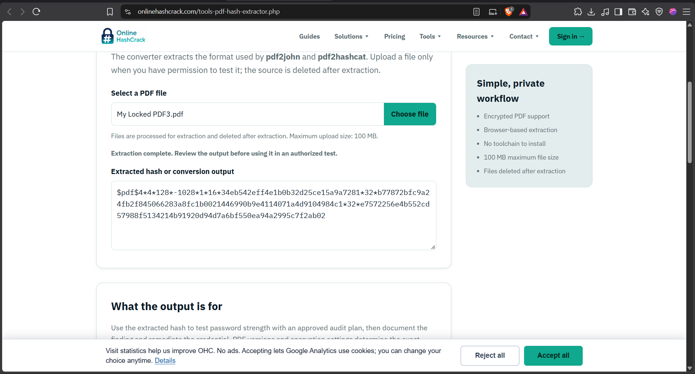
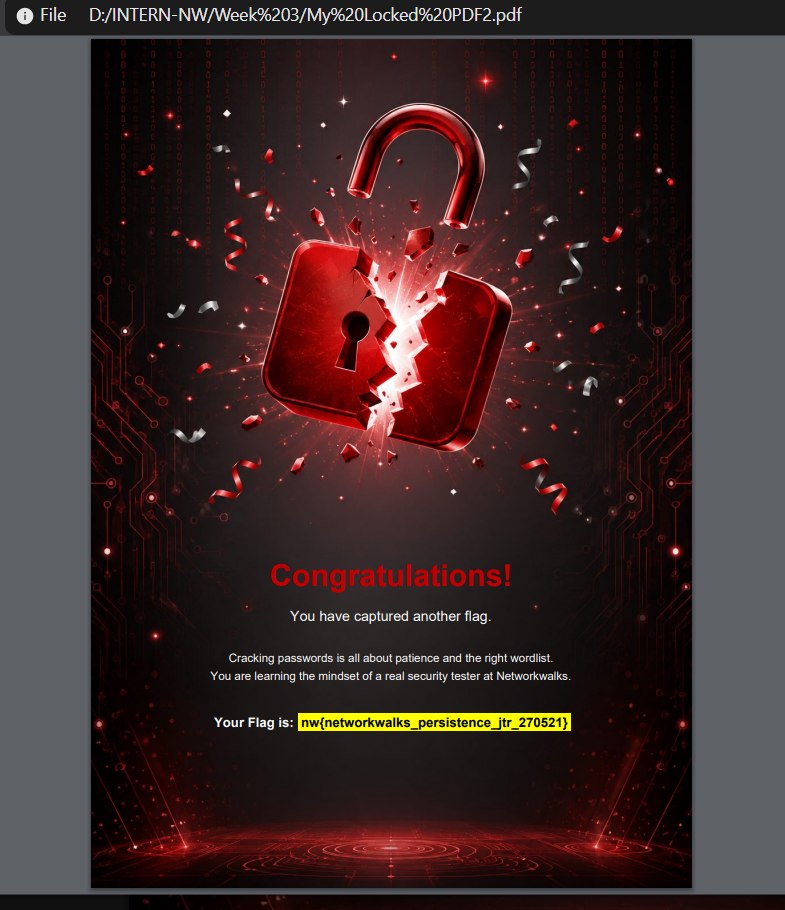
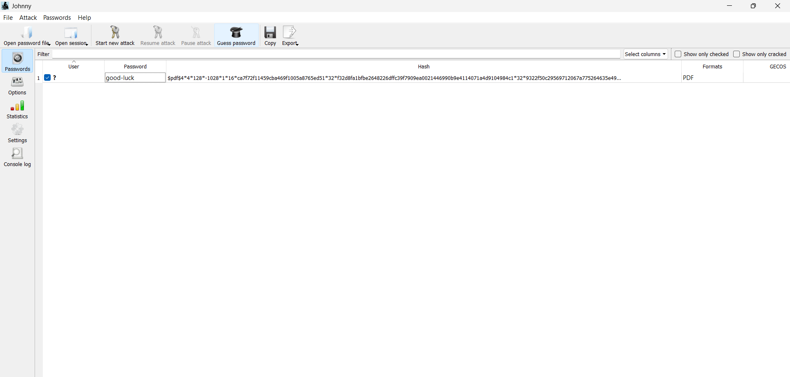
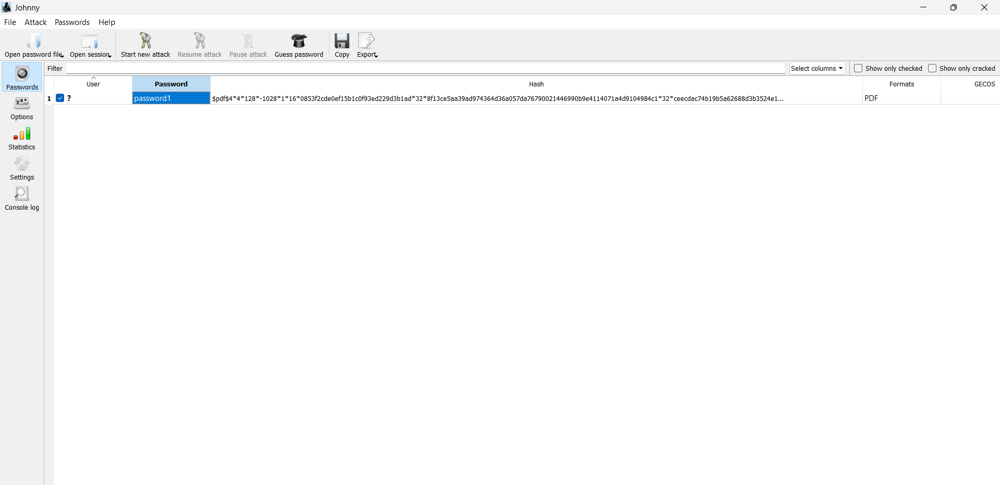

# 1. Introduction
This report covers the task of Password Cracking with JTR and NetworkWalks tools.   
<b>_Password cracking_</b> is the process of recovering a password from stored data or a protected file. Security
professionals use it to test how strong a password is and to show why weak passwords are risky. If a
password is short or common, it can be found quickly, which proves the need for strong passwords.  
<b>_John the Ripper (JTR)_</b>  is a popular password cracking tool used by security professionals to test how strong
passwords are. It started as a tool for Unix systems but now works on Windows, Linux, and Mac. It can
check many types of password hashes and also unlock password protected files like PDF, ZIP, and Office
documents. And, Johnny is the graphical version of John the Ripper.  
In case of tools from networkwalks, first I have used the <b>_Hash Calculator_</b>  to take the hash out of a locked PDF file. Then, I've used the <b>_Password Cracker_</b>  to find the real password from that hash. Both tools run in  web browser, so no need to install anything.

# 2. Tools Used
The table below lists each tool used in this report and its purpose.

| Tool | Purpose |
|---|---|
| [Online Hash Crack](https://www.onlinehashcrack.com/tools-pdf-hash-extractor.php) | Generating hashes of locked PDFs |
| [John the Ripper (JTR)](https://www.openwall.com/john/) | Unlocking password-protected files like PDFs |
| [NW Hash Calculator](https://networkwalks.com/hash-calculator/) | Extracting the hash from a locked PDF file |
| [NW Password Cracker](https://networkwalks.com/password-cracker/) | Finding the real password from that hash |

All the files to crack are listed under the folder named as Essential Files.

# 3. Procedure
## Using John The Ripper:
STEP 1: &nbsp;   Download John the Ripper from official website on your windows PC. 
STEP 2: &nbsp;   Download [Johnny GUI](https://openwall.info/wiki/john/johnny) from official website. 
STEP 3: &nbsp;   Run the setup file & install those tools.  
STEP 4: &nbsp;   Download the encrypted PDF file to your PC. (Added here as My Locked PDF1, 2 and 3)  
STEP 5: &nbsp;   Open the online hash crack website & upload your pdf file to find its hash. 
STEP 6: &nbsp;   Select & copy the hash value. Open notepad and Paste the hash value inside notepad. Thus, Save the file with name hash1.txt.  
STEP 7: &nbsp;   Open Johnny, Click on ‘Open password file’, Browse to the hash1.txt file that you have just saved & click on Open.  
STEP 8: &nbsp;   Click on ‘Start new attack’ 
STEP 9: &nbsp;   PDF file password will be cracked. 
STEP 10:&nbsp;   Use this password to open your PDF file. 
## Using NetworkWalks Tools:
STEP 1: &nbsp;   Download the encrypted PDF file (My Locked PDF1.pdf). 
STEP 2: &nbsp;   Open the Networkwalks Hash Calculator in your web browser. 
STEP 3: &nbsp;   Upload the locked PDF file to the Hash Calculator. The tool will read the file and give you the hash value.  
STEP 4: &nbsp;   Copy the full hash value. 
STEP 5: &nbsp;   Open the Networkwalks Password Cracker in your web browser. 
STEP 6: &nbsp;   Paste the hash value into the Password Cracker and start the attack. The tool will try different
passwords until it finds a match.  
STEP 7: &nbsp;   Wait for the tool to finish. The cracked password will be shown on the screen.  
STEP 8: &nbsp;   Open the locked PDF file and enter the cracked password. 

# 4. Evidences

\
\
\
\
\
\
\

--THE END--

